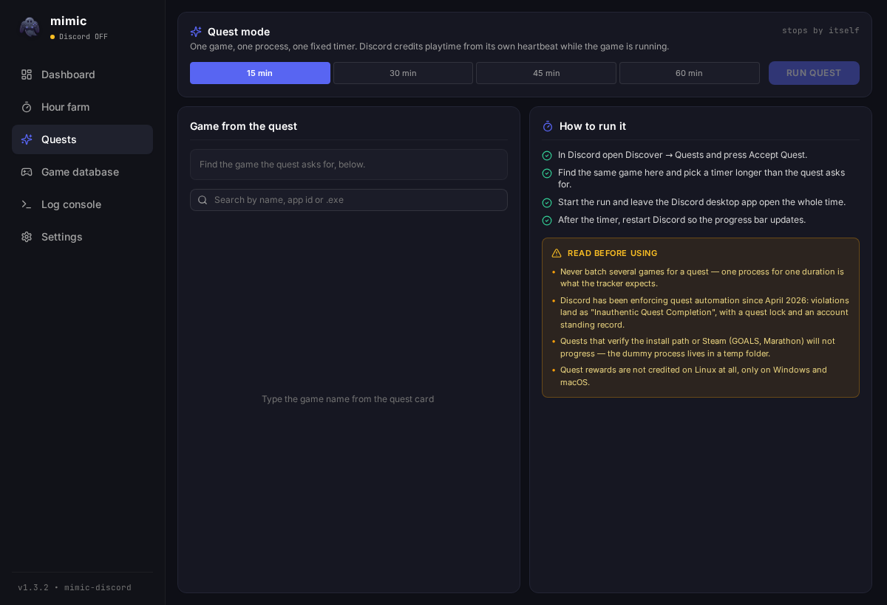

# mimic-quests

A fork of [mimic-discord](https://github.com/Timon2306/mimic-discord) that adds a Discord quest mode.

The original runs games in batches of 8 for 15 seconds to grind the profile badges. A play quest ("play the game for 15 minutes") needs the opposite: one game, one process, one fixed timer. That is what this fork adds.



## What changed

- **Quests** tab (`src/components/QuestView.tsx`): pick a single game from Discord's official detectable-games database (native `.exe` only), choose 15/30/45/60 minutes, and the run stops by itself. A checklist and the honest limits sit right next to the controls.
- Before this, a quest was done by hand through the hour-farm tab: no 15-minute preset existed, so you had to pick "until stopped" and hit stop yourself.
- The chosen game and duration persist in `localStorage`.
- Run state moved from `isFarmRun` to `runKind` (`dashboard` / `farm` / `quest`) so each tab only reacts to its own run.
- Version bumped to 1.4.0. The Rust backend is untouched.

## How it works

Discord credits a play quest from its own heartbeat: while the desktop client sees the game process running, it reports progress. mimic launches a copy of a tiny helper binary renamed to the game's `.exe` from `GET /api/v9/applications/detectable`. In quest mode exactly one process runs for the chosen duration, then it is killed and the temp folder is removed.

Quest mode rides the same backend path as the hour farm (a one-element `farm_game_ids` plus `farm_duration_secs`), so it neither rotates games nor writes history.

## What will not work

- **Quests that verify the install path or platform** (GOALS, Marathon): Discord checks that the game sits inside `steamapps/common` and reads the Steam manifest. The dummy process lives in a temp folder, so those quests will not progress.
- **`executable_fingerprint`** in the heartbeat is a 192-byte native attestation only a real game binary can produce. A spoofer sends none; inventing a value is worse than sending nothing.
- **Linux**: quest rewards are not credited at all, Windows and macOS only.

## Risks

Since April 2026 Discord has been enforcing against quest automation: an "Inauthentic Quest Completion" violation, a 14–15 day quest lock, and a record in account standing (account-wide, not just quests). Renamed `.exe` files and custom paths have been caught too. It is your account — your call.

The binaries are unsigned, the app spawns hidden processes and writes `.exe` files into `%TEMP%`, so antivirus may complain. The backend code is unchanged in this fork: the only network endpoints are `discord.com` (games database) and `cdn.discordapp.com` (icons), and the Discord token is never read.

## Build

```bash
npm install
npm run tauri dev     # run
npm run tauri build   # installer / AppImage / deb
```

Node.js 18+ and Rust 1.75+ (on Linux also `libwebkit2gtk-4.1-dev`, `libgtk-3-dev`, `libayatana-appindicator3-dev`, `librsvg2-dev`).

## Not carried over from upstream

- `.github/workflows/build.yml` — pushing workflow files requires the `workflow` token scope, which this fork's token does not have. Restore CI with `gh auth refresh -s workflow` and copy the workflow from upstream.
- `proof.png` — the author's badge screenshot.

## License

MIT. Original © Timon2306 ([mimic-discord](https://github.com/Timon2306/mimic-discord)), fork changes © TheWeeeen. Full text in [LICENSE](LICENSE).
