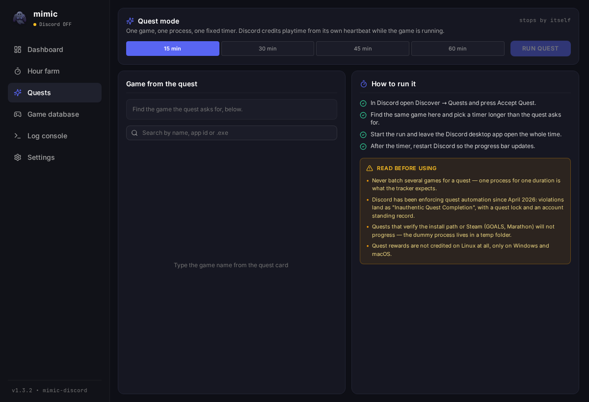

# mimic-quests

Форк [mimic-discord](https://github.com/Timon2306/mimic-discord) с режимом квестов Discord.

Оригинал гоняет игры батчами по 8 на 15 секунд, чтобы прокачать значки «Универсал» и «Время в играх». Для квестов («поиграть 15 минут») нужен ровно противоположный сценарий: одна игра, один процесс, один фиксированный таймер. Это и добавлено.



## Что добавлено

- Вкладка **«Квесты»** (`src/components/QuestView.tsx`): выбор одной игры из официальной базы Discord (только нативные `.exe`), таймер 15/30/45/60 минут, авто-стоп по таймеру, чеклист и предупреждения прямо в интерфейсе.
- Раньше квест закрывался через вкладку «Фарм часов» вручную: пресетов 15 минут там нет, приходилось ставить «До остановки» и жать «Стоп» самому.
- Выбранная игра и длительность запоминаются в `localStorage` между запусками.
- Общий стейт прогонов переведён с `isFarmRun` на `runKind` (`dashboard` / `farm` / `quest`), чтобы вкладки не путали чужой запуск со своим.
- Версия поднята до 1.4.0, бэкенд не менялся.

## Как это работает

Discord засчитывает плей-квест по собственному heartbeat: пока клиент видит запущенный процесс игры, он отправляет прогресс. mimic поднимает копию мини-бинарника (`dummy`) с именем нужного `.exe` из базы `GET /api/v9/applications/detectable` — в режиме квеста ровно один процесс на заданное время, после чего он убивается и временная папка чистится.

Режим квеста использует тот же путь, что «Фарм часов» (`farm_game_ids` из одного элемента + `farm_duration_secs`), поэтому не пишет в историю и не ротирует игры.

## Что не сработает

- **Квесты с проверкой пути/платформы** (GOALS, Marathon): Discord смотрит, что игра стоит в `steamapps/common`, и учитывает Steam-манифест. Dummy-процесс живёт во временной папке, так что такие квесты не закроются.
- **`executable_fingerprint`** в heartbeat — 192-байтная нативная аттестация, её может дать только реально запущенный бинарник игры. Спуф её не отправляет; подделывать значение хуже, чем не отправлять.
- **Linux**: награды за квесты не начисляются в принципе, только Windows и macOS.

## Риски

С апреля 2026 Discord банит за автоматизацию квестов: violation «Inauthentic Quest Completion», лок квестов на 14–15 дней и запись в account standing (это уже на весь аккаунт, а не только на квесты). Ловят в том числе переименованные `.exe` и кастомные пути. Это твой аккаунт — решай сам.

Бинарники не подписаны, приложение плодит скрытые процессы и пишет `.exe` в `%TEMP%`, поэтому антивирус может ругаться. Код бэкенда в форке не менялся: сеть — только `discord.com` (база игр) и `cdn.discordapp.com` (иконки), токен Discord не читается.

## Сборка

```bash
npm install
npm run tauri dev     # запуск
npm run tauri build   # инсталлятор/AppImage/deb
```

Нужны Node.js 18+ и Rust 1.75+ (на Linux ещё `libwebkit2gtk-4.1-dev`, `libgtk-3-dev`, `libayatana-appindicator3-dev`, `librsvg2-dev`).

## Что не перенесено из апстрима

- `.github/workflows/build.yml` — для пуша workflow-файлов нужен scope `workflow`, которого нет у токена. CI легко вернуть: `gh auth refresh -s workflow` и скопировать воркфлоу из апстрима.
- `proof.png` — скриншот значка автора.

## Лицензия

MIT. Оригинал © Timon2306 ([mimic-discord](https://github.com/Timon2306/mimic-discord)), изменения форка © TheWeeeen. Текст лицензии — в [LICENSE](LICENSE).
